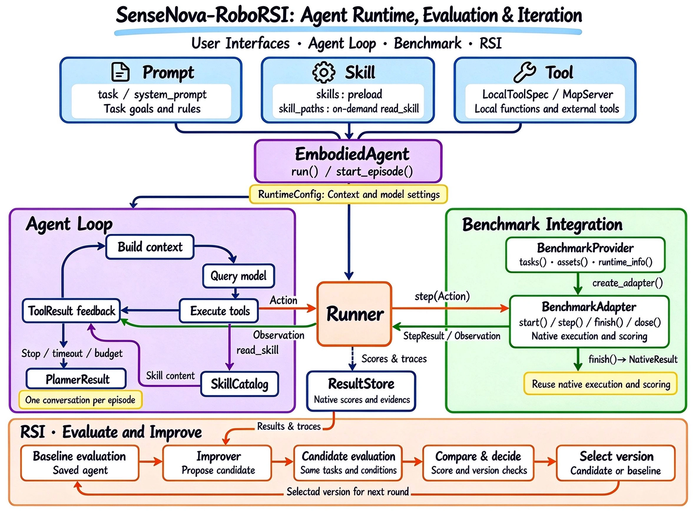

<h1 align="center">SenseNova-RoboRSI: Recursive Self-Improvement for Embodied Agents</h1>

<p align="center"><strong>Build, evaluate, and improve embodied agents with a shared runtime.</strong></p>

<p align="center">
  
  
  
</p>

<p align="center">
  <strong>English</strong> · <a href="README.zh-CN.md">简体中文</a> ·
  <a href="#quick-start">Quick Start</a> · <a href="docs/README.md">Docs</a> ·
  <a href="#modelzoo">ModelZoo</a> · <a href="#results">Results</a> ·
  <a href="#release-plan--roadmap">Release plan</a>
</p>

## News

- **2026-10-16** — Initial code and usage guides for **LIBERO, LIBERO-PRO, LIBERO-Long++ and LIBERO-Ultra-Long** are available in this branch. See the [getting started guide](docs/getting-started.md).

- **2026-10-16** — SenseNova-RoboRSI has been used in the empirical report [**Has GPT-6 Achieved Embodied Intelligence?**](assets/has_gpt-6_achieved_embodied_intelligence.pdf).

- **2026-10-09** — SenseNova-RoboRSI achieves an **average score of 60.08** and a **success rate of 54.17%** on RoboDojo, a gain of **+31.11 points** over the GPT-6 Astra baseline (**28.97**). Results are being submitted to the official RoboDojo leaderboard. See [Results](#results) for benchmark comparisons.

## Overview

Connect your model, skills, and robot tools through a shared runtime, customize
prompts and context, and evaluate policies in environments that retain their
native execution and scoring logic.

On top of this runtime, **recursive self-improvement (RSI)** uses execution
traces and task feedback to improve the Harness while keeping model parameters
fixed. Candidate changes are retested, and validated improvements are carried
into the next agent version, connecting task execution with continuous improvement.

<p align="center">
  
</p>

### Core capabilities

#### Harness: A shared runtime

- **Flexible agent interfaces.** Connect models, prompts, skills, and tools/MCP;
  configure context and caching to suit each task.
- **Unified execution and evaluation.** Run VLA skills, scripted actions, or
  end-effector tools across benchmarks with native feedback and scoring.
- **Experiment records and training data.** Record full traces, export training
  episodes, and run batch evaluations with concurrency and recovery.

#### RSI: Continuous Harness improvement

- **Learn from execution feedback.** Refine action prediction, planning,
  feedback, and memory organization while keeping model parameters fixed.
- **Retest and retain improvements.** Track agent versions, evaluate candidate
  changes under the same task conditions, and carry validated improvements forward.

## Quick Start

Use Python 3.10–3.12 for the Agent and evaluator. From the repository root:

```bash
python -m venv .venv
source .venv/bin/activate
python -m pip install -e '.[runtime,test]'
bench --help
```

On Windows, activate with `.venv\Scripts\Activate.ps1`.

Follow the [installation and first evaluation guide](docs/getting-started.md)
to prepare a benchmark and run a fixed-action or model Agent. Native benchmark
images target Linux; connecting to an existing HTTP benchmark requires no local
simulator installation.

- **Benchmark setup:** [LIBERO](benchmarks/libero/README.md),
  [LIBERO-PRO](benchmarks/libero_pro/README.md), and
  [LIBERO-Long++ / LIBERO-Ultra-Long](benchmarks/libero_lilo/README.md).
- **Agent configuration:** [Models, prompts, context and budgets](docs/agents.md).
- **Evaluation:** [Batch execution, results and resume](docs/evaluation.md).

## ModelZoo

Available Agent methods and upcoming releases by benchmark. The released LIBERO
entries share configurable EmbodiedAgent presets; select your model in the
preset and follow the corresponding benchmark directory for setup and evaluation.

| Benchmark | Status |
| --- | --- |
| RoboDojo | Coming soon |
| [LIBERO-Pro](benchmarks/libero_pro/) | Released |
| [LIBERO-Long++](benchmarks/libero_lilo/) | Released |
| [LIBERO-Ultra-Long](benchmarks/libero_lilo/) | Released |
| RoboLab | Coming soon |
| Bench2Dex | Coming soon |
| DexJoCo | Coming soon |
| LHVLN | Coming soon |
| VLN-CE | Coming soon |
| SIMPLE | Coming soon |
| BEHAVIOR-1K | Coming soon |

## Results

Each table shows SenseNova-RoboRSI alongside selected reference results. Higher is better.

### [RoboDojo](https://robodojo-benchmark.com/)

On RoboDojo-Sim, SenseNova-RoboRSI achieves an **average score of 60.08** and a
**success rate of 54.17%**. Compared with the **GPT-6-Astra** baseline, this is a
gain of **31.11 score points** and **31.69 percentage points** in success rate.

**Leaderboard submission:** Our results are being submitted to the official RoboDojo leaderboard. The official results may vary slightly; we will update the results here once they are available.

| Method | Average score ↑ | Success rate ↑ |
| --- | ---: | ---: |
| SenseNova-RoboRSI / GPT-6 Astra (ours) | **60.08** | **54.17%** |
| EmbodiedEvo | 45.08 | 38.95% |
| VPP2 | 39.26 | 32.26% |
| PhysicalRSI | 36.27 | 31.38% |
| Awomo-0.5 | 35.34 | 29.64% |
| Simate-beta | 33.95 | 27.96% |
| GPT-6-Astra (baseline) | 28.97 | 22.48% |

Reference results: [RoboDojo simulation leaderboard](https://robodojo-benchmark.com/leaderboard)
(updated **2026-10-14**, accessed **2026-10-15**).

### [LIBERO-PRO](https://zxy-mllab.github.io/LIBERO-PRO-Webpage/)

| Method | Success rate ↑ |
| --- | ---: |
| SenseNova-RoboRSI / GPT-6 Astra (ours) | **94.50%** |
| RPent / GPT-6 Astra | 92.63% |
| RPent / Opus-4.7 | 82.40% |
| RPent / GPT-5.5 | 75.13% |
| RPent Flash Mode / Molmo2-8B | 72.63% |

The reference scores above, including GPT-6 Astra's 92.63%, are reported by [RPent](https://rpent.readthedocs.io/zh-cn/latest/rst_source/leaderboard/performance.html) on Task/Swap suites. The [official LIBERO-PRO leaderboard](https://github.com/Zxy-MLlab/LIBERO-PRO#-libero-pro-model-leaderboard) reports a different aggregate across five perturbation types.

### [RoboCasa365](https://robocasa.ai/)

| Method | Evaluation setting | Success rate ↑ |
| --- | --- | ---: |
| SenseNova-RoboRSI / GPT-6 Astra (ours) | Target kitchens + task memory | **64.60%** |
| Paimon-0 | Pretraining kitchens | 58.10% |
| Xiaomi-Robotics-1 | Pretraining kitchens | 57.40% |
| Phasor-m7 | Pretraining kitchens | 56.80% |
| ProWAM | Pretraining kitchens | 48.10% |

Reference results: [official RoboCasa leaderboard](https://robocasa.ai/leaderboard.html). SenseNova-RoboRSI uses the Target50 setting; the official entries use pretraining kitchens. These results provide context across different evaluation settings and do not establish a ranking under the same protocol.

## Release Plan & Roadmap

### Release plan

- [x] Project introduction
- [x] [Empirical Study](assets/has_gpt-6_achieved_embodied_intelligence.pdf)
- [x] Initial code release: Agent runtime and LIBERO-family evaluation
- [x] [Usage documentation](docs/README.md)
- [ ] Demo

### Research roadmap

- **Experience retrieval.** We plan to organize successful strategies, failure
  cases, and execution traces into a searchable experience library.
- **Transfer across tasks and environments.** We will investigate whether tool
  combinations, planning strategies, and feedback mechanisms validated in one
  setting can provide useful starting points in another.
- **More robot platforms and real-world scenarios.** We aim to extend integration
  and evaluation to more robot embodiments and physical settings, and examine the
  reliability of feedback-driven improvement in those environments.

## Community & Acknowledgements

We welcome collaboration with teams working on foundation models,
VLA policies, simulation platforms, and real robots.

- **Contributions:** We welcome new integrations, evaluation tasks,
  reproducible failure cases, and suggestions for Harness design. See the
  [contribution guide](CONTRIBUTING.md) for the current release scope and checks.
- **Questions & collaboration:** Open an
  [issue](https://github.com/OpenSenseNova/SenseNova-RoboRSI/issues)
  describing your platform, use case, and proposed contribution.
- **Release updates:** Watch the
  [SenseNova-RoboRSI repository](https://github.com/OpenSenseNova/SenseNova-RoboRSI).
- **Acknowledgements:** We thank
  [RoboDojo](https://robodojo-benchmark.com/),
  [LIBERO-PRO](https://zxy-mllab.github.io/LIBERO-PRO-Webpage/),
  [RoboCasa](https://robocasa.ai/), and the broader open-source
  community supporting embodied-agent research.
- **Licenses:** External models, simulators, and datasets retain
  their respective licenses.

**This achievement reflects the joint team's continued exploration and close collaboration in embodied AI and agent systems. SenseNova-RoboRSI has been used in the published report [Has GPT-6 Achieved Embodied Intelligence?](assets/has_gpt-6_achieved_embodied_intelligence.pdf). We will continue to advance and validate these technologies.**
