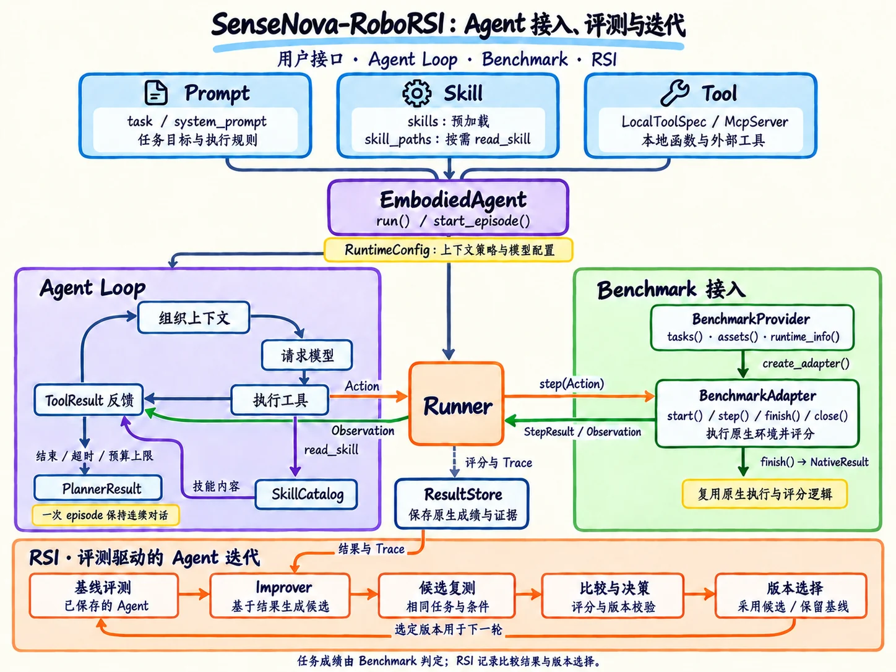

<h1 align="center">SenseNova-RoboRSI：具身智能体的递归自我改进</h1>

<p align="center"><strong>通过统一运行框架，构建、评测并迭代具身 Agent。</strong></p>

<p align="center">
  
  
  
</p>

<p align="center">
  <a href="README.md">English</a> · <strong>简体中文</strong> ·
  <a href="#quick-start">快速开始</a> · <a href="docs/README.md">使用文档</a> ·
  <a href="#modelzoo">ModelZoo</a> · <a href="#results">实验结果</a> ·
  <a href="#release-plan--roadmap">发布计划</a>
</p>

## News

- **2026-10-16** — 本分支已提供 **LIBERO、LIBERO-PRO、LIBERO-Long++ 和 LIBERO-Ultra-Long** 的首批代码与使用指南，详见[快速开始](docs/getting-started.zh-CN.md)。

- **2026-10-16** — SenseNova-RoboRSI 作为实验框架支持了实证研究 [**Has GPT-6 Achieved Embodied Intelligence?**](assets/has_gpt-6_achieved_embodied_intelligence.pdf)。

- **2026-10-09** — SenseNova-RoboRSI 在 RoboDojo 上取得 **60.08 的平均得分**和 **54.17% 的成功率**，平均得分较 GPT-6 Astra 基线（**28.97**）提升 **+31.11 分**。结果正在提交至 RoboDojo 官方榜单。更多评测对比见 [Results](#results)。

## Overview

通过统一运行框架接入模型、技能与机器人工具，配置提示词和上下文，并在保留原生执行与
评分逻辑的环境中评测策略。

在此基础上，**递归自我改进（RSI）** 利用执行轨迹与任务反馈，在保持模型参数不变的前提下
优化 Harness。候选改进经过复测验证后，有效变化被继承到下一 Agent 版本，
将任务执行与持续改进连接起来。



### 核心能力

#### Harness：通用运行框架

- **灵活的 Agent 接口**：接入模型、提示词、技能与工具/MCP，按任务配置上下文和缓存策略。
- **统一执行与评测**：跨基准调用 VLA 技能、脚本动作或末端控制工具，保留原生反馈与评分。
- **实验记录与训练数据**：记录完整轨迹、导出训练 episode，支持并发批量评测与中断恢复。

#### RSI：持续改进 Harness

- **从执行反馈中改进**：保持模型参数不变，优化动作预测、任务规划、执行反馈与记忆组织。
- **复测并保留有效变化**：记录 Agent 版本，在相同任务条件下评测候选改进，并将验证有效的变化继承到后续版本。

## Quick Start

Agent 和评测器使用 Python 3.10–3.12。在仓库根目录执行：

```bash
python -m venv .venv
source .venv/bin/activate
python -m pip install -e '.[runtime,test]'
bench --help
```

Windows 使用 `.venv\Scripts\Activate.ps1` 激活环境。

按照[安装与首次评测指南](docs/getting-started.zh-CN.md)准备 benchmark，运行固定动作
或模型 Agent。原生 benchmark 镜像面向 Linux；连接已有 HTTP benchmark 服务时，
无需在本机安装模拟器。

- **Benchmark 配置：** [LIBERO](benchmarks/libero/README.md)、
  [LIBERO-PRO](benchmarks/libero_pro/README.md) 和
  [LIBERO-Long++ / LIBERO-Ultra-Long](benchmarks/libero_lilo/README.md)。
- **Agent 配置：** [模型、提示词、上下文与预算](docs/agents.zh-CN.md)。
- **评测：** [批量执行、结果查看与中断恢复](docs/evaluation.zh-CN.md)。

## ModelZoo

按 benchmark 列出已开源的 Agent 方法与即将开源的内容。当前已开源的 LIBERO 三项
共用可配置的 EmbodiedAgent 预设；在预设中选择模型，并按对应评测目录完成环境准备与评测。

| Benchmark | 状态 |
| --- | --- |
| RoboDojo | 即将开源 |
| [LIBERO-Pro](benchmarks/libero_pro/) | 已开源 |
| [LIBERO-Long++](benchmarks/libero_lilo/) | 已开源 |
| [LIBERO-Ultra-Long](benchmarks/libero_lilo/) | 已开源 |
| RoboLab | 即将开源 |
| Bench2Dex | 即将开源 |
| DexJoCo | 即将开源 |
| LHVLN | 即将开源 |
| VLN-CE | 即将开源 |
| SIMPLE | 即将开源 |
| BEHAVIOR-1K | 即将开源 |

## Results

每张表列出 SenseNova-RoboRSI 与部分参考结果，分数越高越好。

### [RoboDojo](https://robodojo-benchmark.com/)

SenseNova-RoboRSI 在 RoboDojo-Sim 上取得 **60.08 的平均得分**和 **54.17% 的成功率**。
相比 **GPT-6-Astra** 基线，平均得分提升 **31.11 分**，成功率提升 **31.69 个百分点**。

**榜单提交：** 我们的结果正在提交至 RoboDojo 官方榜单。官方结果可能略有差异；待官方结果公布后，我们将更新此处的结果。

| 方法 | 平均得分 ↑ | 成功率 ↑ |
| --- | ---: | ---: |
| SenseNova-RoboRSI / GPT-6 Astra（我们） | **60.08** | **54.17%** |
| EmbodiedEvo | 45.08 | 38.95% |
| VPP2 | 39.26 | 32.26% |
| PhysicalRSI | 36.27 | 31.38% |
| Awomo-0.5 | 35.34 | 29.64% |
| Simate-beta | 33.95 | 27.96% |
| GPT-6-Astra（基线） | 28.97 | 22.48% |

参考结果：[RoboDojo 仿真榜单](https://robodojo-benchmark.com/leaderboard)
（更新于 **2026-10-14**，访问于 **2026-10-15**）。

### [LIBERO-PRO](https://zxy-mllab.github.io/LIBERO-PRO-Webpage/)

| 方法 | 成功率 ↑ |
| --- | ---: |
| SenseNova-RoboRSI / GPT-6 Astra（我们） | **94.50%** |
| RPent / GPT-6 Astra | 92.63% |
| RPent / Opus-4.7 | 82.40% |
| RPent / GPT-5.5 | 75.13% |
| RPent Flash Mode / Molmo2-8B | 72.63% |

上表参考成绩由 [RPent](https://rpent.readthedocs.io/zh-cn/latest/rst_source/leaderboard/performance.html) 在 Task/Swap 套件上测得并公布，其中 GPT-6 Astra 为 92.63%。[LIBERO-PRO 官方榜单](https://github.com/Zxy-MLlab/LIBERO-PRO#-libero-pro-model-leaderboard) 汇总五类扰动，统计口径不同。

### [RoboCasa365](https://robocasa.ai/)

| 方法 | 评测设置 | 成功率 ↑ |
| --- | --- | ---: |
| SenseNova-RoboRSI / GPT-6 Astra（我们） | Target 厨房 + 任务记忆 | **64.60%** |
| Paimon-0 | 预训练厨房 | 58.10% |
| Xiaomi-Robotics-1 | 预训练厨房 | 57.40% |
| Phasor-m7 | 预训练厨房 | 56.80% |
| ProWAM | 预训练厨房 | 48.10% |

参考结果：[RoboCasa 官方榜单](https://robocasa.ai/leaderboard.html)。SenseNova-RoboRSI 使用 Target50 设置，官方榜单条目在预训练厨房中评测。以上为不同评测设置下的结果参考，不构成同一协议下的排名。

## Release Plan & Roadmap

### 发布计划

- [x] 项目介绍
- [x] [实证研究](assets/has_gpt-6_achieved_embodied_intelligence.pdf)
- [x] 首批代码：Agent 运行时与 LIBERO 系列评测
- [x] [使用文档](docs/README.md)
- [ ] Demo

### 后续研究方向

- **经验检索：** 计划将成功策略、失败案例与执行轨迹整理为可检索的经验库。
- **跨任务和跨环境迁移：** 将探索已验证的工具组合、规划策略与反馈机制，
  能否为其他任务与环境提供有效起点。
- **更多机器人平台与真实场景：** 希望将接入与评测扩展到更多机器人本体和物理场景，
  检验反馈驱动的持续改进在这些环境中的可靠性。

## Community & Acknowledgements

欢迎基础模型、VLA、仿真平台与真实机器人相关团队参与合作。

- **参与贡献：** 欢迎新的接口接入、评测任务、可复现的失败案例，
  以及 Harness 设计建议。当前发布范围与检查要求见[贡献指南](CONTRIBUTING_zh.md)。
- **问题与合作：** 通过
  [Issues](https://github.com/OpenSenseNova/SenseNova-RoboRSI/issues)
  说明所用平台、应用场景与希望参与的方向。
- **发布进展：** 关注
  [SenseNova-RoboRSI 仓库](https://github.com/OpenSenseNova/SenseNova-RoboRSI)。
- **致谢：** 感谢
  [RoboDojo](https://robodojo-benchmark.com/)、
  [LIBERO-PRO](https://zxy-mllab.github.io/LIBERO-PRO-Webpage/)、
  [RoboCasa](https://robocasa.ai/) 和相关开源社区
  对具身 Agent 研究的支持。
- **许可证：** 外部模型、模拟器与数据集遵循各自的许可证。

**这一成果凝聚了联合团队在具身智能与 Agent 系统方向上的持续探索和紧密协作。SenseNova-RoboRSI 已用于现已发布的实证研究 [Has GPT-6 Achieved Embodied Intelligence?](assets/has_gpt-6_achieved_embodied_intelligence.pdf)。未来，我们将继续推动相关技术的迭代与验证。**
